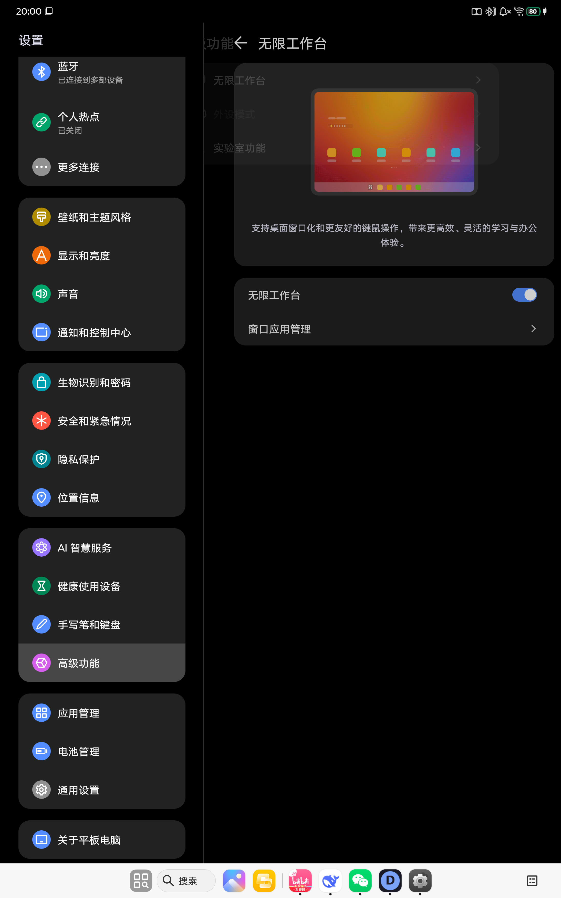

<div align="center">

# Doge IDE+

**Android 平板上的本地 C/C++ 与 Python IDE —— 编译和运行全程离线，不依赖任何云端沙箱。**

[](LICENSE)
[](#支持矩阵)
[](android/app/build.gradle)
[](#为什么是零依赖)
[-lightgrey.svg)](#支持矩阵)

[特性](#特性) · [截图](#截图) · [快速开始](#快速开始) · [架构](#架构) · [测试](#测试) · [文档索引](#文档索引) · [贡献](#贡献)

</div>

---

## 简介

Doge IDE+ 是一个面向 **13 英寸 Android ARM64 平板**的本地 IDE，用一整个 APK 提供
C/C++ 与 Python 的编辑、补全、编译、运行和终端能力。

它最初是一个依赖云端执行服务的 Web IDE。本项目把执行链路整体搬到了设备内部：
Clang 编对象文件 → `wasm-ld` 链接成 WASI 模块 → **WAMR** 在进程内运行，
Python 则由导入的启动器以子进程方式执行。**设备拿到本地运行库之后，断网也能编译和运行。**

桌面端是同一套前端的另一种封装：Go + WebView2，把 `doge-ide.html` 和 `web/**` 直接
`embed` 进单个 exe，在 `127.0.0.1:8787` 上提供同源页面。

> 仓库里的 `doge-ide.html` 是**前端主文件**，Android 与 Windows 两端共用，不是构建产物。

---

## 特性

### 编辑器

- **CodeMirror 5** 内核，C/C++、Python、JSON、Markdown 等多语言高亮，随输入法安全的中文输入处理
- **项目内头文件识别**：`#include "` 自动列出项目头文件；被 include 的头文件里声明的函数、宏、类型、
  枚举常量、结构体成员进入补全候选并置顶，显示函数签名与来源文件
- **clangd 语言服务**：补全、诊断、跳转，文档版本化同步；C++ 服务与 Python / 数据文件相互隔离
- **输入法边界处理**：组字中不误触 Tab、选区替换、IME 与焦点切换后输入不丢失
- 三种主题（现代 / 经典 / 纯黑），可选编程连字，全角字符诊断
- 编辑配对（括号、引号自动闭合），成对输入与选区替换

### 编译与运行

- **C/C++**：Clang 逐文件编译 → `wasm-ld` 统一链接 → WAMR（`libiwasm.so`）WASI 执行，
  stdout / stderr / 退出码实时回传，编译、链接、运行三阶段均带超时
- **Python**：独立子进程 + 导入的启动器，实时输出、运行中输入
- **交互式终端**：xterm.js 前端 + WASI 有序输入与重放；Enter 发送、Shift+Enter 换行
- **有界运行会话**：任务串行队列、输出游标、可停止、保留最终结果

### 工程

- **零第三方 Gradle 依赖** —— 不使用 AndroidX，一个进程、一个 APK，无后台常驻服务
- **同源架构**：页面与 `/api/v1/**` 都来自 `127.0.0.1`，天然无 CORS，`localStorage` 行为与桌面版一致
- **本机接口鉴权**：每次启动生成 `X-Doge-Session` 令牌，普通浏览器访问回环接口无法取得
- **SAF 项目目录**：兼容 Android 7.0，已持久化的读写权限
- 前端资源由 Gradle `syncWebapp` 任务从仓库根目录同步，改前端无需手动复制

---

## 截图

<div align="center">



<sub>13 英寸平板横屏 · 编辑器 / 文件树 / 终端同屏</sub>

</div>

---

## 快速开始

### 支持矩阵

| 目标 | 平台 | 最低版本 | 产物 |
|---|---|---|---|
| Android 平板 | ARM64 (`arm64-v8a`) | Android 7.0 / API 24 | `DogeIDEPlus-<版本>-debug.apk` |
| Windows 桌面 | x64 | Windows 10+ (WebView2) | `exe/DogeIDE.exe` |

Android 端 `targetSdk` **刻意压到 28**：target 29+ 禁止从应用私有目录执行导入的工具链，
而本地编译正依赖这一行为。`compileSdk` 为 35。

### 构建 Android APK

前置条件：**JDK 17～21**（AGP 8.7 要求，JDK 25 会被 Gradle 拒绝）。Android SDK 不必预装，
脚本能按需下载。

```powershell
# 缺什么装什么，然后构建 release
pwsh -File android\build-apk.ps1

# 只出 debug 包（测试用，无需签名配置）
pwsh -File android\build-apk.ps1 -Task assembleDebug

# 指定 SDK / JDK，并允许脚本下载 commandline-tools 与 licenses
pwsh -File android\build-apk.ps1 -SdkRoot "D:\Android\Sdk" -JdkPath "C:\Program Files\Java\jdk-17" -InstallSdk
```

脚本流程：校验 JDK 主版本 → 定位（或下载）Android SDK 与 `platforms;android-35`、
`build-tools;35.0.0` → 定位（或下载）Gradle ≥ 8.9（默认 8.11.1）→ 执行
`gradle -p android <Task>` → 打印 APK 路径、大小与 `adb install` 命令。

产物：
`android/app/build/outputs/apk/release/app-release.apk`（`assembleRelease`）
或 `android/app/build/outputs/apk/debug/app-debug.apk`（`assembleDebug`）。

> **正式签名**：`android/app/build.gradle` 会读取 `android/keystore.properties`
> （已在 `.gitignore` 中）。缺少该文件时 `assembleRelease` 会主动失败，避免产出
> debug 签名的 release 包。自建密钥：
>
> ```powershell
> keytool -genkeypair -v -keystore android\doge-release.jks -alias doge `
>         -keyalg RSA -keysize 2048 -validity 10000
> ```

### 构建 Windows 桌面版

```powershell
pwsh -File exe\build.ps1           # release -> exe/DogeIDE.exe
pwsh -File exe\build.ps1 -Debug    # 带控制台 -> exe/DogeIDE-debug.exe
```

脚本优先使用 `exe/.toolchain/go`（便携版 Go），否则回退到 PATH 上的 `go`；
`GOPROXY` 默认指向 `goproxy.cn`，所有缓存落在 `exe/.tmp`。

也可以直接跑源码（浏览器而不是 WebView2）：

```bash
./start.bat      # Windows：启动本地服务并自动打开 http://localhost:8787
```

`start.bat` 优先用 `node proxy.mjs`，没有 Node 时回退到 `python proxy.py`。

### 导入本地运行库

APK 本身**不含**编译工具链（保持体积可控），首次使用需要在应用内导入资源包：

| 资源包 | 用途 |
|---|---|
| `doge-cpp-arm64-0.1.0.zip` | Clang / wasm-ld / 头文件，C/C++ 本地编译 |
| `doge-python` 启动器包 | Python 解释器与标准库 |

导入后设备处于「本地运行就绪」状态，编译运行不再联网。资源包未导入时接口返回
`runtime_not_ready`（HTTP 503），页面据此提示先导入。

> 资源包体积较大（C/C++ 包约 235 MB），不随仓库分发，见 [release/](release/) 下各版本的
> `RELEASE-NOTES.md` 与其记录的 SHA-256。

---

## 架构

### 共享前端

```
doge-ide.html            单页应用：编辑器、文件树、终端、设置、诊断导出
web/codemirror/**        CodeMirror 5 与插件（hint / dialog / 多语言 mode）
web/terminal/**          xterm.js、终端会话与视图
web/fonts/**             Maple Mono（可变字重）、Geist
```

两端共用同一个 `doge-ide.html`，通过同源的 `/api/v1/**` 与宿主通信，因此在 Android
与 Windows 上页面行为一致。

### Android：Java WebView 壳 + 进程内运行时

```
MainActivity        WebView、沉浸式全屏、返回键、资源包导入、SAF 项目目录
LocalServer         127.0.0.1 迷你 HTTP 服务（8 线程，keep-alive）
LocalCompiler       Clang 编译 + wasm-ld 链接 → WASI 模块
NativeWasmRunner    JNI 桥接 WAMR（libiwasm.so）执行
PythonRunner        Python 子进程、实时输出、运行中输入
TaskRegistry        串行任务队列、输出游标、停止与最终结果
ClangdService       C/C++ 补全、诊断、LSP 文档同步
RuntimeCompat       API 24 的文件读写与进程操作兼容
```

启动链路：`MainActivity` 拉起 `LocalServer` → WebView 打开 `http://127.0.0.1:8787`
（端口占用时自动退到随机端口）→ 页面通过 `DogeNative.executionToken()` 取得
`X-Doge-Session` 令牌 → 之后的 `/api/v1/execution/run` 请求携带该令牌。

它解决三件事：页面与接口**同源**（无 CORS、无需给 `file://` 放开跨域）、
`localStorage` 与 `fetch` 语义和桌面版一致、执行完全发生在设备本地。

WAMR 的 JNI 入口在 `android/app/src/main/cpp/wasm_runner.c`，负责 WASI 的
stdin / stdout / stderr 与超时。

### Windows：Go + WebView2

`main.go`（`//go:build windows`）用 `embed` 把前端打进二进制，在
`127.0.0.1:8787` 起本地服务，再用 `go-webview2` 开窗口加载它。
`proxy.mjs` / `proxy.py` 是同一套接口协议的非 Go 实现，便于脱离 WebView2 调试前端。

### 为什么是零依赖

Android 端不使用 AndroidX、不引入任何第三方 Gradle 依赖：一个进程、一个 APK，
没有常驻后台服务，权限面最小化，也避免了依赖升级带来的构建漂移。

---

## 测试

测试分四层，全部在 `test/` 下：

| 层 | 文件 | 说明 |
|---|---|---|
| 浏览器冒烟 | `test/browser-smoke-*.mjs` | 输入法、补全、选区替换、终端、Python、符号、主题等场景，headless 驱动真实页面 |
| 前端基线 | `test/frontend-baseline.mjs` | 页面结构、可见文案、版本号一致性等基线断言 |
| 运行时回归 | `test/RuntimeRegression.java`、`test/runtime-regression.ps1` | 编译 / 链接 / 执行链路与 Android API 24 兼容性 |
| 协议与运行时 | `test/proxy-regression.mjs`、`test/wasi-terminal-regression.py`、`test/python-bootstrap-regression.py` | 接口协议、WASI 终端有序输入、Python 启动器 |

```powershell
# 一次性跑全部校验
pwsh -File test\batch-verify.ps1

# 单个浏览器冒烟用例
node test/browser-smoke-input.mjs
```

`doge-ide.html` 里的 `APP_VERSION` 与 `android/app/build.gradle` 的 `versionName`
必须一致，这条规则由测试守护（见 `doge-ide.html:2534`）。

---

## 文档索引

`report/` 记录了每个功能的设计、缺陷定位与修复验证，按日期归档：

| 文档 | 内容 |
|---|---|
| [IDE-GAP-REPORT-1.0.0.md](report/IDE-GAP-REPORT-1.0.0.md) | 1.0.0 与成熟 IDE 的能力差距盘点 |
| [INTERACTIVE-TERMINAL-IMPLEMENTATION-2026-10-05.md](report/INTERACTIVE-TERMINAL-IMPLEMENTATION-2026-10-05.md) | 交互式终端实现 |
| [EDITOR-SYMBOLS-2026-10-07.md](report/EDITOR-SYMBOLS-2026-10-07.md) | 项目内头文件符号识别 |
| [EDITOR-INPUT-FIX-2026-10-07.md](report/EDITOR-INPUT-FIX-2026-10-07.md) | 输入法 / 焦点切换下的输入恢复 |
| [HARDWARE-KEYBOARD-INPUT-FIX-2026-10-11.md](report/HARDWARE-KEYBOARD-INPUT-FIX-2026-10-11.md) | 外接键盘输入路径 |
| [SOGOU-WEBVIEW-SOURCE-AUDIT-2026-10-12.md](report/SOGOU-WEBVIEW-SOURCE-AUDIT-2026-10-12.md) | 输入法在 WebView 中的源码级行为核查 |
| [android/README.md](android/README.md) | Android 端构建、签名、运行时结构的完整说明 |

---

## 版本

当前开发版本 **1.1.9**（见 `android/app/build.gradle`）。已归档的测试发布版在
[release/](release/)，含 APK、`SHA256SUMS.txt` 与逐版本 `RELEASE-NOTES.md`。

---

## 第三方组件

| 组件 | 许可 | 位置 |
|---|---|---|
| [CodeMirror 5](https://codemirror.net/5/) | MIT | `web/codemirror/` |
| [xterm.js](https://xtermjs.org/) | MIT | `web/terminal/vendor/` |
| [Maple Mono](https://github.com/subframe7536/maple-font) | OFL-1.1 | `web/fonts/maple-mono-var.woff2` |
| [Geist](https://vercel.com/font) | OFL-1.1 | `web/fonts/geist/` |
| [WAMR](https://github.com/bytecodealliance/wasm-micro-runtime) | Apache-2.0 | `android/app/src/main/jniLibs/arm64-v8a/libiwasm.so` |
| [go-webview2](https://github.com/jchv/go-webview2) | MIT | `go.mod` |

详见 [THIRD-PARTY-NOTICES.md](THIRD-PARTY-NOTICES.md)。

---

## 贡献

欢迎 issue 与 PR。提交前请确保：

1. `pwsh -File test\batch-verify.ps1` 全部通过；
2. 若改动 `versionName`，同步更新 `doge-ide.html` 里的 `APP_VERSION`；
3. 前端改动不需要手动拷贝到 `android/app/src/main/assets` —— 构建时由 `syncWebapp` 同步。

---

## 许可

本项目以 [MIT License](LICENSE) 开源。

<div align="center">
<sub>Doge IDE+ · 让平板上也能离线写 C/C++</sub>
</div>
